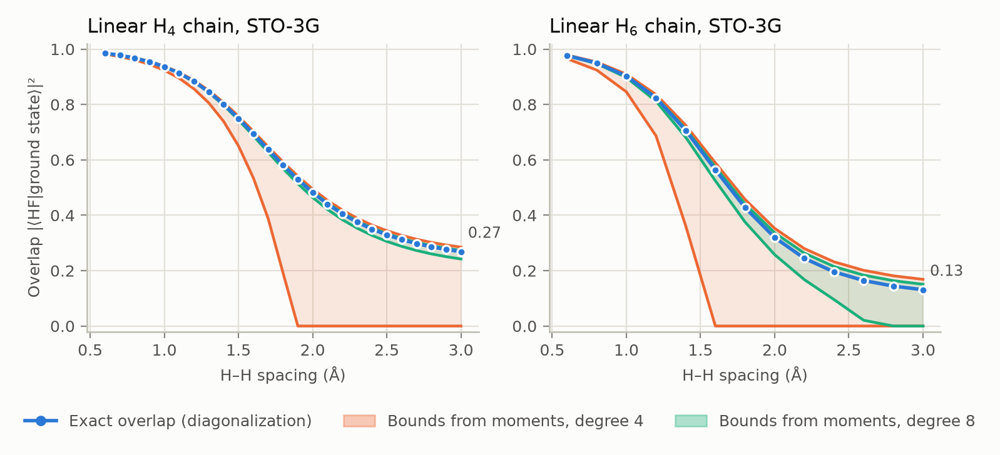
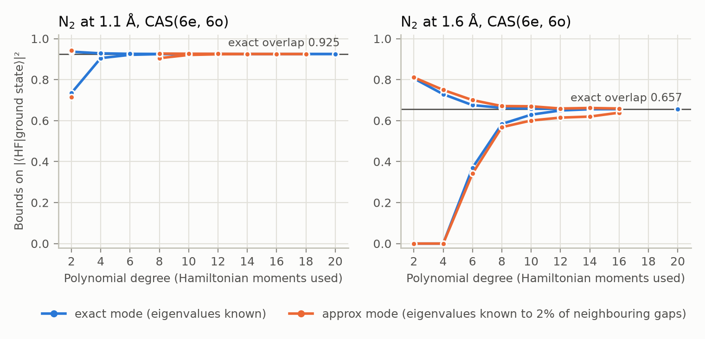
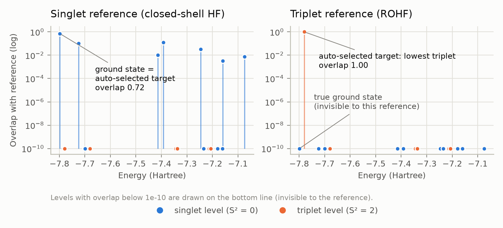
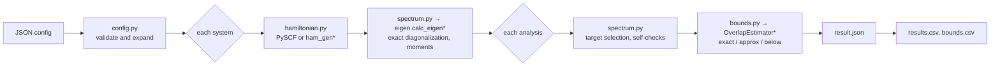

# OverlapAnalyzer

[](https://github.com/aayaansingal/OverlapAnalyzer/actions/workflows/tests.yml)

OverlapAnalyzer computes **rigorous upper and lower bounds on the overlap between a prepared quantum state and a target eigenstate** of a molecular Hamiltonian, using only Hamiltonian moments ⟨ψ|Hᵏ|ψ⟩. That overlap sets the success probability of quantum phase estimation (QPE), so the bounds tell you, before running QPE, whether an initial state is good enough.

This repository continues the research code of **Junan Lin** (original repository: [JunanLin/OverlapAnalyzer](https://github.com/JunanLin/OverlapAnalyzer)), which implements the method of:

> Junan Lin and Artur F. Izmaylov, *Bounding Eigenstate Overlap from Hamiltonian Moments: Success Probability Guarantees for Quantum Phase Estimation*, [arXiv:2503.12224](https://arxiv.org/abs/2503.12224) (2025).

On top of that work, this fork adds an **automated molecular experimentation framework**. It sweeps molecules, geometries, basis sets, spin states and active spaces through the full pipeline, and it **picks the physically relevant eigenstate automatically**. It also caches and resumes work, checks every result for self-consistency, and writes tidy result tables. Along the way it fixes several bugs in the original code and adds a 99-test validation suite.

<picture>
  <source media="(prefers-color-scheme: dark)" srcset="docs/images/bond_scan-dark.png">
  
</picture>

---

## Contents
- [Background](#background)
- [Original work and contributions](#original-work-and-contributions)
- [Results](#results)
- [Installation](#installation)
- [Usage](#usage)
- [Architecture](#architecture)
- [Validation and testing](#validation-and-testing)
- [Limitations](#limitations)
- [Repository layout](#repository-layout)
- [Citing and license](#citing-and-license)

## Background

For a state |ψ⟩ and Hamiltonian H = Σᵢ Eᵢ|i⟩⟨i|, the moments are mₖ = ⟨ψ|Hᵏ|ψ⟩ = Σᵢ |⟨ψ|i⟩|² Eᵢᵏ. Suppose a polynomial p(E) lies above (or below) the indicator function of a target energy window at every possible eigenvalue. Then Σₖ cₖmₖ is a guaranteed upper (or lower) bound on the overlap with the eigenstates in that window. Finding the tightest such polynomial is a linear or semidefinite program. Raising the polynomial degree uses more moments and tightens the bounds. `OverlapEstimator` (in `overlapanalyzer/polynomial_majorisation_LB.py`) implements three settings:

| Mode | What is assumed known | Solver |
|---|---|---|
| `exact` | all eigenvalues | LP (SciPy HiGHS) |
| `approx` | each eigenvalue only to within a fraction of the gap to its neighbours | SDP (cvxpy, SCS by default) |
| `below` | only an energy threshold and the spectral range; bounds the total overlap below the threshold | SDP |

## Original work and contributions

| Area | Origin |
|---|---|
| Bounding method, `OverlapEstimator`, LP/SDP formulations (`polynomial_majorisation_LB.py`, `polynomial_estimates.py`) | Junan Lin |
| Exact diagonalization and moment generation (`eigen.py`), Hamiltonian generation via QCC (`ham_gen.py`), Krylov/contour/partitioning research code, tutorial notebook | Junan Lin |
| Automated sweep framework (`overlapanalyzer/sweep/`), `overlap-sweep` command | this fork |
| PySCF Hamiltonian route that works without the non-public `qcc_240202` package | this fork |
| Test suite (`tests/`), example and demonstration configs, figures (`scripts/make_figures.py`), packaging and CI | this fork |
| Bug fixes in the original code (listed below) | this fork |

The shared history up to commit `1f1510c` (2025-12-08) comes directly from the original repository; later commits are this fork's.

**Fixes to the original code.** Each fix is a minimal, targeted change with a regression test:
- `approx` mode bounded the wrong energy region, or crashed, whenever the target was not one of the two lowest levels. After merging non-target levels into regions, the target's *level* index was used as a *region* index (`process_bound_pairs`).
- `below` mode bounded the overlap *above* the threshold. It assumed low energies map to −1, but the stored rescaling maps the ground state to +1.
- The `s1` (open-shell singlet) reference built by `calc_eigen` was actually the Sz = 0 *triplet*, because of a sign error.
- `approx` and `below` modes crashed with duplicate keyword arguments.
- `ham_gen` used RHF instead of ROHF for triplet active-space runs, because of an always-true condition.
- Plotting failed without a LaTeX installation, and an incompatible optional dependency (`krypy`) broke unrelated imports.

## Results

All numbers and figures below come from the example sweeps in `examples/sweeps/`. They are regenerated by `scripts/make_figures.py`, and the underlying tables are committed in [`docs/results/`](docs/results/).

**Overlap along a bond stretch** (figure above, `demo_bond_scan.json`; 38 systems).
- **As the bonds stretch, the Hartree–Fock state's overlap with the ground state falls:** from 0.985 to 0.269 for H₄ and from 0.977 to 0.131 for H₆.
- **Higher-degree polynomials tighten the bounds sharply.** The widest H₄ bound interval is 0.54 at degree 4 and 0.031 at degree 8.
- **All 152 bound pairs contain the exact overlap.**

<picture>
  <source media="(prefers-color-scheme: dark)" srcset="docs/images/bound_convergence-dark.png">
  
</picture>

**Convergence with the number of moments** (`demo_bound_convergence.json`, N₂ in a (6e, 6o) active space).
- **Near equilibrium (1.1 Å):** the bound width drops from 0.20 at degree 2 to 0.001 at degree 8.
- **Stretched (1.6 Å), a strongly correlated case:** more moments are needed, with widths of 0.31 at degree 6, 0.030 at degree 10 and 0.0013 at degree 14.
- **Gaps in the curves are deliberate.** Points where a solver reported a non-optimal status are left out. At degree 20 the default SCS solver reported `optimal_inaccurate` for `approx` mode, and those bounds miss the exact value by up to 3×10⁻³; see [Limitations](#limitations).

<picture>
  <source media="(prefers-color-scheme: dark)" srcset="docs/images/spin_sector-dark.png">
  
</picture>

**Automatic target selection** (`lih_active_space.json`, LiH at 3.0 Å, (2e, 5o)).
- **Triplet reference:** the true ground state is a singlet with overlap below 10⁻⁷⁴, so bounding the "ground state" would be meaningless. The `lowest_in_sector` strategy picks the lowest *triplet* instead (overlap 1.00).
- **Singlet reference:** the ground state itself is selected (overlap 0.72).

**Validation sweep** (`validation_suite.json`): 68 experiments across H₂, linear and square H₄, H₆, HeH⁺, and active-space LiH, BeH₂, H₂O and N₂, with all three reference spins and all three bound modes.
- **All 68 completed**, and every result passed both exact self-consistency checks.
- **All 476 bound intervals contain the exact value.**
- **9 of 476 SDP solves reported `optimal_inaccurate`.** Each is flagged in the output.

## Installation

Requires Python ≥ 3.11 (tested with 3.13 on macOS).

```bash
git clone https://github.com/aayaansingal/OverlapAnalyzer.git
cd OverlapAnalyzer
python -m venv .venv && source .venv/bin/activate
pip install -e ".[dev]"          # core + pytest; adds the `overlap-sweep` command
python -m pytest tests/          # about 40 s
```

Tested with: numpy 2.5.4, scipy 1.18.1, pandas 3.0.6, matplotlib 3.11.2, openfermion 1.8.1, openfermionpyscf 0.5, pyscf 2.14.0, cvxpy 1.9.3, Mosek 11.2.6.

**Optional extras.** The sweep framework and the bounding method need none of these; they are only for parts of the original research code.

| Extra | Needed for | Notes |
|---|---|---|
| `pip install -e ".[julia]"` | `partitioning.py` (QuantumMAMBO) | Needs Julia 1.9.3: copy `juliapkg.json` into `.venv/julia_env/pyjuliapkg/`, then run `python setup-julia.py` |
| `pip install -e ".[krylov]"` | `precond_utils.py` | `krypy` 2.2.0 does not import on recent SciPy |
| `pip install -e ".[iqcc]"` | `iQCC.py`, `ham_gen.py` | Also needs the non-public `qcc_240202` package |

MOSEK is installed as a dependency because `polynomial_majorisation_LB.py` imports it, but it is only *used* with `"solver": "MOSEK"`, which also needs a MOSEK license. The default solver, SCS, is free.

## Usage

### Run a sweep

```bash
overlap-sweep validate examples/sweeps/h_chain_bond_scan.json   # check the config, list the experiments
overlap-sweep run examples/sweeps/h_chain_bond_scan.json        # run; run again to resume
overlap-sweep run CONFIG --jobs 4                               # process systems in parallel
overlap-sweep run CONFIG --retry-failed                         # recompute failed experiments
overlap-sweep status CONFIG                                     # complete / failed / stale / pending
overlap-sweep summarize CONFIG                                  # rebuild the summary tables
```
(`python -m overlapanalyzer.sweep ...` is equivalent.) Exit codes: 0 everything complete, 1 failures or unfinished work, 2 invalid config, 3 output directory in use, 130 interrupted.

### Configuration

A config lists **systems** and **analyses**. Every combination of the two is one experiment. List-valued system fields expand into every combination.

```json
{
  "sweep_name": "lih_scan",
  "systems": [
    {"molecule": "lih", "geometries": {"start": 1.2, "stop": 3.0, "num": 4},
     "basis": "sto-3g", "spin": ["s0", "t1"],
     "active_space": {"active_electrons": 2, "active_spatial_orbitals": 5}}
  ],
  "analyses": [
    {"name": "sector_ground", "target": {"strategy": "lowest_in_sector"},
     "modes": ["exact", "approx"], "poly_degrees": [4, 8, 12], "bound_extension": 0.02}
  ]
}
```

| System field | Meaning |
|---|---|
| `molecule` | `h2`, `lih`, `beh2`, `h2o`, `n2`, `h4` (ring of four H, geometry = H–centre–H angle in degrees; 90 is a square), `h4_linear`, `nh3`, `h2x2` (from `utils.get_molecular_data`), `h_chain` (+ `n_atoms`), or custom `atoms` with a `name` |
| `geometries` | list, `{start, stop, num}` or `{start, stop, step}`; bond lengths in Å unless the molecule defines otherwise |
| `basis`, `spin` | any PySCF basis; reference `s0` (closed-shell HF), `t1` (high-spin triplet, ROHF orbitals) or `s1` (open-shell singlet) |
| `active_space` | `{active_electrons, active_spatial_orbitals}`, frozen core taken from the lowest orbitals |
| `backend`, `charge`, `overlap_threshold` | `pyscf` (default) or `ham_gen`; molecular charge; minimum overlap for a level to be a bound constraint |

| Analysis field | Meaning |
|---|---|
| `target.strategy` | `lowest_with_overlap` (default; lowest level with overlap ≥ `min_overlap`), `max_overlap`, `index`, `lowest_in_sector` (lowest level with the reference's spin) |
| `modes`, `poly_degrees` | any of `exact`, `approx`, `below`; degrees 0–40 |
| `bound_extension` | `approx` mode: eigenvalue uncertainty as a fraction (0 to 0.5) of the gap to each neighbouring level |
| `energy_threshold` | `below` mode: Hartree value or `"HF"` |
| `solver`, `save_plots`, `recipe_overrides` | `SCS` or `MOSEK`; save upstream bound plots; extra `OverlapEstimator` recipe keys |

`limits.max_dimension` (default 6000) caps the size of the dense diagonalization.

### Outputs

`sweeps/<sweep_name>/` (gitignored) contains:
- `results.csv`: one row per experiment, with exact quantities, the deepest-degree bounds, self-check flags, warnings and timings.
- `bounds.csv`: one row per mode and degree, with lower and upper bounds, width, the exact reference value, `brackets_exact`, and solver status.
- `results.jsonl`, plus per-system folders containing the Hamiltonian, the diagonalization, `result.json` files and logs.

### Single run

`scripts/run_overlap_simulation.py` runs one system by hand: edit the configuration block, then run it. `scripts/make_figures.py` reproduces everything in [Results](#results).

## Architecture


<sub>* original research code, called unchanged except for the fixes listed above</sub>

| Module (`overlapanalyzer/sweep/`) | Responsibility |
|---|---|
| `config.py` | Strict schema, up-front validation, expansion, content-hash ids |
| `hamiltonian.py` | Hamiltonian generation in the file layout `calc_eigen` expects; active spaces |
| `spectrum.py` | Diagonalization wrapper, level table with spin, target strategies, exact self-checks |
| `bounds.py` | One `OverlapEstimator` call per mode; per-degree parsing, solver status, margins against the exact value |
| `runner.py` | Stage caching, staleness tracking, failure isolation, parallel workers, resume, summaries |
| `storage.py`, `cli.py` | Atomic JSON writes, stage records, output lock, provenance; command-line interface |

How the runner stays reliable:
- **Separate caching for the expensive and cheap parts.** A *system* (Hamiltonian plus diagonalization, the expensive part) is cached separately from an *analysis* (target plus bounds), so changing an analysis never repeats a diagonalization.
- **Staleness tracking.** Every stage records a code version and a token for the upstream computation it was built from. After a code fix or `--force`, dependent results show as `stale` and are recomputed.
- **Crash safety.** Writes are atomic, so interrupted runs resume cleanly, in parallel mode too. A crashed worker never overwrites finished results. A lock prevents two runs from sharing an output directory.

## Validation and testing

`python -m pytest tests/` runs 99 tests in about 40 s:
- **Reference energies:** HF and FCI energies match the Psi4 reference data shipped with OpenFermion to 10⁻⁶ Ha: H₂/STO-3G at five bond lengths, H₂/6-31G, and LiH/STO-3G.
- **Reference overlaps:** ground-state energies and |⟨HF|ground⟩|² match PySCF FCI/CASCI wavefunctions to 10⁻⁸ for dissociated H₂, linear and square H₄, HeH⁺, and active-space BeH₂, H₂O and N₂.
- **Bound properties:** on random synthetic spectra, bounds contain the exact value for every target position, and exact-mode bounds tighten monotonically with degree.
- **Reliability:** cache invalidation, recovery from corrupted caches, locking, worker-crash recovery, determinism of parallel versus sequential runs, Ctrl-C and resume through the real command line, and exit codes.
- **Self-checks in every result:** the moment identity Σᵢ|⟨ψ|i⟩|²Eᵢᵏ = mₖ, the reference ⟨S²⟩ versus its spin label, solver status, and whether each bound contains the exact value. These checks found the `s1` and `approx`-mode bugs.

## Limitations

- **Small systems only:** diagonalization is dense, so systems are limited to a few thousand determinants (`limits.max_dimension`). Larger molecules need an active space, and choosing one is a scientific decision. Validated systems go up to 924 determinants.
- **Exact values come from diagonalization:** they serve as a reference for the bounds. In a real use case the moments would come from elsewhere, for example tensor networks, as in the paper.
- **SCS accuracy at high degree:** at high polynomial degree, SCS can return `optimal_inaccurate`, and such bounds are not guaranteed valid. These cases are flagged in `bounds.csv` and `warnings`. Use lower degrees, or MOSEK (licensed; not tested here).
- **Untested routes:** the `ham_gen` route (needs `qcc_240202`) and licensed MOSEK. Odd-electron molecules need a doublet reference, which `calc_eigen` does not provide.
- **Legacy modules:** the Krylov, contour-integration, iQCC and partitioning modules of the original code are kept as they were and are not covered by the tests.

## Repository layout

```
overlapanalyzer/          original research package (Junan Lin)
overlapanalyzer/sweep/    automated sweep framework (this fork)
examples/sweeps/          example and demonstration configs
scripts/                  single-run script, figure generation
docs/images, docs/results figures and the result tables behind them
docs/source/tutorial/     original tutorial notebook
tests/                    test suite
juliapkg.json, setup-julia.py   optional Julia/QuantumMAMBO setup
```

## Citing and license

If you use the bounding method, please cite the paper above. The underlying research code is by Junan Lin; see the [original repository](https://github.com/JunanLin/OverlapAnalyzer).

No license file has been added yet, so default copyright applies until one is chosen.
